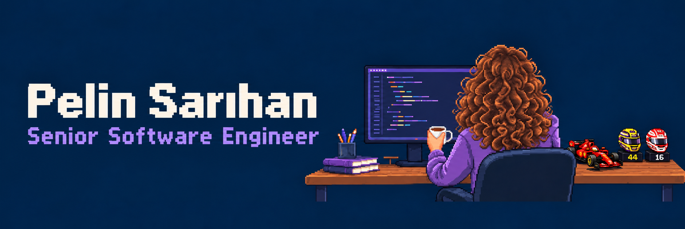

[YouTube](https://www.youtube.com/watch?v=V4zVu91LsjU) · [Kommunity](https://kommunity.com/ozgur-yazilim-toplulugu/events/building-resilience-stable-microservices-pelin-sarihan-71d57069) · [LinkedIn](https://www.linkedin.com/in/pelinsarihan/)
